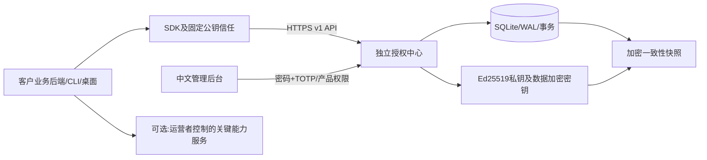

# 第一阶段：方案与规则

## 默认假设与威胁模型

授权中心运营者可信；客户机器、客户源码、浏览器、传入 Host/实例标识、代理头都不可信。攻击者可能窃取兑换码、重复请求、并发兑换、伪造设备、篡改缓存、修改时间、回滚快照、逆向 SDK。授权中心失陷或签名私钥泄露属于信任根失陷，必须按应急流程更换信任。数据库管理员也能改审计记录，本版本审计不是不可篡改账本。

客户通过持有兑换码获得首次激活权限；许可证管理密钥用于新增实例及续费；实例密钥仅用于刷新、严格在线检查及解绑；管理员有独立密码+TOTP认证。产品标识本身从不赋予授权。客户身份 `customer` 是运营记录标签，不是已认证账户，不能把它用于证明账户所有权。

默认固定时长：体验 3 天、周 7 天、月 30 天、年 365 天，1 天为 86400 秒。自然月/自然年未实现，不能用这两个名称暗示支持。产品 ID 是稳定逻辑标识；issuer 是不随物理服务器变化的稳定逻辑身份。HTTPS 服务域名通过 DNS 迁移。

## 架构

核心业务与授权中心不共享表、不共享私钥；产品接入只改配置、SDK适配及业务校验点。API 可作为未来无状态节点，但**本交付采用单主机 SQLite 写锁**，不支持多服务器挂载同一个 SQLite 文件；不得使用 NFS、共享盘或双主复制冒充集群。多进程单主机仍受全局写锁串行化限制，默认仅一个 worker。没有容量基准，不提供未经测量的 QPS 承诺。

选择 Python/FastAPI 是为了较少运维组件、自动 OpenAPI 及直接复用成熟密码库；SQLite 标准备份 API 和 `BEGIN IMMEDIATE` 为第一阶段提供易验证的一致性。扩容到 PostgreSQL 需实现数据库适配、行级锁/唯一约束、迁移及相同并发回归测试，不是只替换连接字符串。

## 对象与状态机

|对象|身份与关系|关键事实|
|---|---|---|
|产品|products.id|名称、当前展示版本，不包含业务密钥|
|套餐|plans.id → product|功能、配额、时间、绑定及联网策略模板|
|兑换码|codes.id → product|HMAC-SHA256摘要、192位随机码、权益快照、次数、用途、兑换截止|
|许可证|licenses.id → product|客户、管理密钥摘要、权益快照、起算/到期/永久、支持及升级期限、版本|
|激活实例|instances.id → license|稳定随机实例标识的SHA-256、实例密钥摘要、租约及凭证到期|
|短期凭证|JWS compact / JWT|由授权中心Ed25519签名，自带明确到期|
|幂等结果|scope+key|请求摘要、加密响应；避免丢失响应后重复发放或加时|
|审计|递增id|成功变更、登录失败、备份及恢复等，不记录原始秘密|

许可证持久状态：`active → paused/revoked`，经管理员显式操作可恢复 `active`。到期/尚未生效是服务端时间派生状态，不在数据库写另一个互相矛盾的状态。到期仍可续费；暂停/撤销均拒绝普通续费，必须先由管理员恢复。暂停期间继续计时，不补偿天数。

实例：已绑定 → 主动解绑/管理员释放 → 等待旧凭证窗口与冷却 → 新绑定。崩溃只影响租约，不能自动删除设备绑定。实例管理密钥遗失需要管理员受控释放，不能由客户端只报产品ID重置。

## 时间和已售权益

- 首次成功兑换激活的事务时间为起点；管理员可在生成码时指定已有UTC起点。未来起点在生效前拒绝兑换，已经过期的起点不消耗码。兑换截止单独校验，不限制已经兑换的许可证。
- 续费从 `max(expires_at, server_now)` 加时；永久续费写 `perpetual=true, expires_at=null`。已有永久权不允许降级为有期。
- 普通续费只延长使用权，不悄悄改变功能、配额或绑定；功能升级码只合并功能及提高配额。支持/升级期限在初次签发时分别计算，null表示未授予该额外权益，不表示永久支持或永久升级；当前无单独延长它们的界面。
- 修改套餐仅影响后续生成的码；已有码和许可证都保留快照。没有已售权益批量追溯修改接口。
- 全部数据库时间是UTC Unix秒，界面使用浏览器时区；管理员时间输入按本地时区转UTC。各机器需要可靠NTP。本版不接受隐式时区字符串。
- 凭证 `exp <= license_exp`；永久权也有有限凭证寿命。不存在到期后自动续宽限。已有合法凭证即是预先授权的离线窗口。

## 并发、绑定与配额

兑换、使用次数增加、许可证创建、实例创建、续费、幂等结果与审计处于同一 `BEGIN IMMEDIATE` 事务；数据库唯一约束辅助。幂等键需16–128字符，SDK使用UUID；同scope同key不同请求返回409。幂等记录长期保存，本版尚无归档策略，需监控体积。

当前实现稳定随机实例绑定、最大设备数、最大同时在线租约。默认实例标识为随机UUID并存于持久化业务状态目录；Docker重建时必须保留该目录。它是隐私友好的软件身份，不是可信硬件证明；克隆整个实例缓存可伪装成同一实例，中心无法分辨多个克隆，不能宣称彻底防复制。

租约与凭证同时到期，刷新同实例不额外占用名额。网络分区时新实例要等待旧租约结束，避免旧凭证合法期间把在线名额提前放给新实例。设备上限计算包含未过期的已释放实例，因此管理员释放也不能绕过旧窗口。自助解绑消耗次数，后续激活受冷却期限制；管理员受控释放可处理设备损坏，保留原许可证期限，不重新计费或重新起算。

业务 `checkQuota` 是当前用量加增量与授权上限的比较，并不是分布式计数器。用户数、节点数、任务数等真实计数，必须由业务后端在自己的事务中锁定与维护。纯前端按钮隐藏不能代替这些判断。

域名/IP绑定尚未开放为已执行策略。拟定域名规则：IDNA转ASCII、小写、去末尾点、拒绝URL路径和用户信息、独立处理端口；精确域不自动包含子域；泛域名 `*.example.com` 只匹配一层且不匹配根域，需独立配置。只有经过运营方DNS/HTTP所有权挑战的域名才可作为证明；来自客户自报的Host不够。服务器能观察连接来源IP，但NAT/代理/出站IP不是部署身份。供应配置默认完全忽略转发IP头，避免伪造；经代理后限流按代理地址聚合，生产需在网关进一步做客户端限流。

体验卡目前是管理员发放的受限兑换码，禁止解释为匿名免费试用防滥用方案。账户+产品+实例的重复体验领取、防批量假账户与实名集成仍待实现；重装和伪造设备不能被绝对阻止。

## 三种联网策略与失效处理

|策略|实现|故障行为|撤销边界|
|---|---|---|---|
|严格在线 online|每次关键操作 `/v1/check`，签名仍本地验证|网络失败拒绝新操作，不降级|下一次成功在线检查；已开始操作按业务安全点收尾|
|周期联网 periodic|默认300秒后台刷新，900秒签名凭证|网络/5xx/限流不等于撤销；仅使用尚有效缓存|最迟当前已签发凭证到期|
|离线 offline|管理员签发有限期文件，SDK导入|不联网；文件或许可证到期拒绝新操作|不能实时撤销；已交付文件到期才失效|

离线文件即使对应永久使用权也有 `offline_max` 上限，当前支持首次签发，尚无保持原许可证身份的离线续签/离线续费流程。最大离线期限不是额外附加的宽限：周期凭证默认与其相同。刷新采用指数退避及随机抖动，连接超时默认5秒。心跳频率按客户规模、撤销SLA和成本调节，不默认每业务请求都刷新。

SDK监测当前进程单调时钟与墙钟差、历史可信服务端时间及缓存记录；整体缓存/虚拟机快照与时钟同时回滚、本地管理员修改SDK都可能绕过。缓存原子替换，POSIX权限0600；Windows必须配合NTFS ACL。

拒绝新任务是默认集成行为，已有任务由业务在安全检查点完成/保存；示例保留导出和修复入口。只读降级需要业务定义具体写操作边界，SDK不远程终止进程、不执行命令、不删除客户数据。

## 签名与可选更强架构

私钥仅在授权中心vault；可信公钥通过你控制的程序发布渠道固定分发。固定 `EdDSA` + Ed25519，拒绝 `none`、HS256、未知kid和头中的URL；不会按照任意URL下载公钥。凭证包含 issuer/product/license/activation/instance/features/quotas/iat/nbf/exp/license_exp/perpetual/jti/ver/status/policy。

轮换保持旧公钥兼容，先分发双公钥配置再切签发密钥。公钥接口只用于管理员分发参考，不自动信任自发现。密钥泄露后旧公钥必须从所有客户端可信配置移除；完全离线客户端未更新前无法获知泄露。详见运维。

要求更强的产品，将关键模型推理、敏感数据、计算、导出签发或业务交易放在运营者控制的服务端，并在该后端做在线授权和业务身份认证。客户仍可修改本地UI，但不能凭本地伪造授权访问你服务端能力。代价是带宽、服务端算力和高可用成本、每次关键能力调用的网络延迟、隐私及数据合规评估；断网无法使用这些关键能力。不存在绝对防破解承诺。
